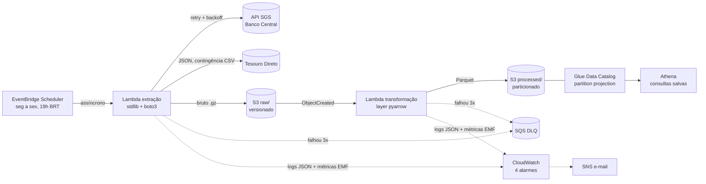

# Pipeline ETL Serverless na AWS


Pipeline de dados serverless que coleta, todo dia útil, as séries de **CDI, Selic e IPCA**
do Banco Central e as taxas dos títulos do **Tesouro Direto**, guarda o bruto no **S3**,
transforma em **Parquet** particionado e deixa tudo consultável por SQL no **Athena**.
Toda a infraestrutura é criada por **Terraform**, sem nenhum clique no console.

É a versão em nuvem do
[coletor de taxas e indicadores](https://github.com/viniciustakeuchi/coletor-taxas-indicadores):
em vez de um processo com PostgreSQL, duas Lambdas e um data lake, que custam centavos por
mês. A consulta `premissas` entrega CDI, Selic e IPCA no formato que a
[API de carteira de renda fixa](https://github.com/viniciustakeuchi/api-carteira-renda-fixa)
usa nas projeções.

## Arquitetura



| Recurso | Para quê |
| --- | --- |
| EventBridge Scheduler | Dispara a extração de segunda a sexta às 19h, no fuso de São Paulo |
| Lambda `extracao` | Baixa as 5 fontes em paralelo e grava o conteúdo bruto, sem alterar |
| S3 `raw/` | Bruto comprimido, versionado: reprocessar não apaga o histórico |
| Lambda `transformacao` | Valida, tipa e grava Parquet; disparada por cada arquivo novo em `raw/` |
| S3 `processed/` | Parquet com schema fixo, particionado por série e dia de coleta |
| Glue + Athena | Tabelas `indicadores` e `tesouro` e três consultas salvas |
| SQS | Fila de eventos que falharam 3 vezes, para reprocessar |
| CloudWatch + SNS | Logs com retenção de 14 dias, métricas e alarmes por e-mail |

### Camadas de dados

```text
s3://pipeline-etl-dados-<conta>/
├── raw/fonte=cdi/data_coleta=2026-10-13/cdi.json.gz
├── raw/fonte=tesouro/data_coleta=2026-10-13/tesouro.json.gz   (ou .csv.gz na contingência)
├── processed/indicadores/serie=cdi/data_coleta=2026-10-13/cdi.parquet
└── processed/tesouro/data_coleta=2026-10-13/tesouro.parquet
```

Cada chave é única por fonte e dia. Rodar de novo no mesmo dia sobrescreve o arquivo, e o
versionamento do bucket guarda a versão anterior por 30 dias.

## Stack

Python 3.12 · AWS Lambda (arm64) · S3 · EventBridge Scheduler · Glue Data Catalog · Athena ·
SQS · SNS · CloudWatch · IAM · Terraform · pyarrow · DuckDB · moto · Pytest · Ruff ·
mypy (strict) · Docker · GitHub Actions (OIDC)

## Como rodar

### Localmente, sem conta AWS

Um S3 local ([moto server](https://docs.getmoto.org/en/latest/docs/server_mode.html)) faz o
papel da AWS. O compose roda as duas Lambdas em sequência contra as fontes reais e imprime
as consultas que, na AWS, rodam no Athena:

```bash
docker compose up --build
```

Sem Docker:

```bash
python -m venv .venv && source .venv/bin/activate
pip install -e ".[dev]"
moto_server -p 5000 &          # ou qualquer S3 compatível
cp .env.example .env && set -a && source .env && set +a

python -m etl.local executar                    # extrai e transforma, como as Lambdas
python -m etl.local executar --data 2026-10-10 --fontes cdi,ipca   # reprocessa
python -m etl.local consultar premissas         # CDI anual, meta Selic, IPCA 12m
python -m etl.local consultar ultimos_indicadores
python -m etl.local consultar curva_tesouro
```

### Na AWS

1. **Bootstrap, uma única vez**, com credenciais de administrador. Cria o bucket do estado
   do Terraform e a role que o GitHub Actions assume via OIDC:

   ```bash
   cd infra/bootstrap && terraform init && terraform apply
   ```

2. **Deploy pelo GitHub Actions.** No repositório, crie o ambiente `producao` com as
   variáveis `AWS_ROLE_ARN` e `TF_STATE_BUCKET` (saídas do bootstrap) e, se quiser alertas,
   `EMAIL_ALERTAS`. A partir daí, cada push na `main` que mexe em `etl/`, `infra/` ou
   `sql/` empacota, aplica o Terraform e roda um teste de fumaça: invoca a extração de
   verdade e consulta o Athena.

   Ou, da sua máquina:

   ```bash
   python scripts/empacotar.py      # build/funcao.zip e build/layer-pyarrow.zip
   cd infra
   terraform init -backend-config="bucket=<state_bucket>"
   terraform apply
   ```

3. **Consultar.** No console do Athena, escolha o workgroup `pipeline-etl` e abra as
   consultas salvas, ou rode:

   ```sql
   SELECT * FROM pipeline_etl_dados.indicadores
   WHERE serie = 'cdi' AND data_coleta >= '2026-10-01';
   ```

### Custo estimado

Para o volume deste pipeline (22 execuções por mês, poucos MB de dados):

| Serviço | Uso mensal | Custo |
| --- | --- | --- |
| Lambda | ~150 invocações, < 200 GB-s | US$ 0 (free tier: 1 milhão e 400 mil GB-s) |
| S3 | < 50 MB e algumas centenas de requisições | < US$ 0,01 |
| Athena | consultas lendo < 10 MB (cobra o mínimo de 10 MB) | ~US$ 0,00005 por consulta |
| EventBridge Scheduler, SQS, SNS, Glue Catalog | bem abaixo dos limites gratuitos | US$ 0 |
| CloudWatch | 4 alarmes e poucos MB de log | US$ 0 (10 alarmes gratuitos) |

Fica abaixo de **US$ 0,10 por mês**. O workgroup do Athena corta qualquer consulta que
tente ler mais de 100 MB, então um `SELECT *` esquecido não gera surpresa.

## Primeiras execuções reais

O workflow [Ensaio com dados reais](.github/workflows/ensaio-real.yml) rodou o pipeline
completo duas vezes em 13/10/2026, com as fontes de verdade e um S3 local:

| Fonte | 1ª execução | 2ª execução |
| --- | --- | --- |
| `cdi` | 0,8 s, 5 dias | 0,8 s, 5 dias |
| `selic` | 0,8 s, 6 dias | 0,3 s, 6 dias |
| `selic_meta` | 0,8 s, 11 dias | 0,8 s, 11 dias |
| `ipca` | 0,4 s, 13 meses | 3,1 s, 13 meses |
| `tesouro` | 0,4 s via API, 58 títulos (47 KB) | 39,6 s via CSV, 116 linhas (14,6 MB) |

Na 2ª execução o site do Tesouro respondeu `403` para a API, e a extração caiu sozinha para
o CSV de dados abertos. A transformação guardou só a janela de 5 dias do CSV (dois dias de
cotação), e a consulta `curva_tesouro` devolveu os mesmos 58 títulos do último dia. Nas
duas execuções, nenhum registro foi rejeitado.

A consulta `premissas` devolveu o mesmo resultado nas duas:

```json
{"cdi_anual": 13.65, "selic_meta": "13.75000000", "ipca_12m": 4.58, "meses_ipca": 12}
```

São os mesmos valores que o
[coletor do projeto 2](https://github.com/viniciustakeuchi/coletor-taxas-indicadores) gravou
no PostgreSQL na mesma data, agora calculados em SQL sobre Parquet.

## Testes e qualidade

```bash
pytest --cov=etl          # 96 testes, 99% de cobertura, nenhum acessa a internet ou a AWS
ruff check . && ruff format --check .
mypy etl tests scripts
```

O CI no GitHub Actions tem quatro jobs:

| Job | O que prova |
| --- | --- |
| `qualidade` | Lint, tipagem estrita e os testes com o S3 simulado pelo moto |
| `terraform` | `fmt` e `validate` e depois **`terraform apply` da infraestrutura inteira** contra o moto server: buckets, Lambdas, layer, IAM, Scheduler, Glue, Athena, SQS e SNS são criados de verdade numa AWS simulada |
| `runtime-lambda` | Os zips gerados pelo `empacotar.py` rodam dentro da **imagem oficial do runtime python3.12** da Lambda: a transformação lê o bruto e grava o Parquet com a layer, e a extração carrega e valida o evento |
| `docker` | A imagem do compose sobe e roda como usuário comum |

E o workflow [Ensaio com dados reais](.github/workflows/ensaio-real.yml) roda o
`docker compose up` contra o Banco Central e o Tesouro de verdade toda segunda-feira, como
canário: se uma fonte mudar de formato, ele quebra antes da produção.

O que os testes cobrem:

- **Parsers** com respostas reais salvas em `tests/fixtures` (SGS, JSON do site do Tesouro e
  CSV do Tesouro Transparente), incluindo itens malformados, `NaN`, IPCA negativo e
  arquivo em latin-1.
- **Contingência do Tesouro**: API fora do ar, API desativada (410), HTML de bloqueio com
  status 200, JSON sem títulos e queda das duas camadas.
- **Handlers** de ponta a ponta com o S3 do moto: chaves, metadados, compressão, falha
  parcial (as outras fontes seguem), falha total (a Lambda falha para acionar retry e DLQ),
  reprocessamento e idempotência.
- **SQL**: as três consultas rodam no DuckDB sobre os Parquets gerados e são validadas no
  dialeto do Athena (Trino) com sqlglot, garantindo que só leem tabelas que o Terraform cria.

## Decisões técnicas

- **Raw imutável e processed derivado.** A extração não interpreta nada: grava exatamente o
  que a fonte respondeu. Se o parser tiver um bug ou a fonte mudar, dá para corrigir o
  código e reprocessar o histórico a partir do raw, sem depender de a fonte ainda ter o dado.
- **Duas Lambdas ligadas por evento do S3, e não uma.** A extração depende de rede e a
  transformação depende do formato. Separadas, cada uma tem seu retry, seu alarme e sua
  permissão mínima, e reprocessar a transformação não chama as fontes de novo.
- **A extração não tem dependências.** urllib e o boto3 do runtime bastam para cinco GETs,
  então o zip tem 15 KB e o cold start é curto. Só a transformação leva a layer com pyarrow.
- **Partition projection em vez de Glue Crawler.** As partições são calculadas a partir do
  padrão das chaves, então um arquivo novo é consultável na hora, sem crawler (que custa e
  atrasa) nem `MSCK REPAIR TABLE`.
- **Snapshots com deduplicação na consulta.** Cada coleta pede os últimos 10 dias ao Banco
  Central, então as datas se repetem entre snapshots. Em vez de reescrever arquivos antigos,
  as consultas ficam com a versão do snapshot mais recente (`row_number() OVER ...`). Uma
  revisão de valor pelo Banco Central aparece sozinha, e há um teste para isso.
- **O mesmo SQL no Athena e no DuckDB.** Os arquivos de `sql/` viram consultas salvas no
  Athena pelo Terraform e rodam no DuckDB nos testes e no compose. A lógica de negócio
  (CDI anualizado, IPCA acumulado) é testada sem AWS.
- **Métricas via Embedded Metric Format.** As métricas (`FontesComFalha`,
  `RegistrosGravados`, duração) saem como uma linha de log JSON que o CloudWatch converte em
  métrica. Não há chamada a `PutMetricData`, nem permissão extra, nem latência.
- **Falha parcial não derruba a execução, mas alarma.** Se só o IPCA falhar, as outras
  fontes são gravadas e a métrica `FontesComFalha` dispara o alarme. Se todas falharem, a
  Lambda falha, o retry assíncrono tenta mais duas vezes e o evento vai para a DLQ.
- **Graviton (arm64).** Mesmo código, cerca de 20% mais barato por GB-s. A layer é montada
  com wheels `manylinux_2_28_aarch64`, compatíveis com o Amazon Linux 2023 do runtime.
- **Deploy sem chave de acesso.** O GitHub Actions assume uma role via OIDC, restrita ao
  ambiente `producao` deste repositório. Nada de `AWS_SECRET_ACCESS_KEY` em segredo do GitHub.
- **Segurança por padrão.** Buckets privados, criptografados e que recusam acesso sem TLS;
  uma role IAM por função, só com as ações que ela usa; logs com retenção definida.

### O que eu faria diferente

- **Permissões da role de deploy.** Ela usa `PowerUserAccess` mais IAM restrito a roles com
  o prefixo do projeto. É seguro contra escalada de privilégio, mas mais amplo que o
  necessário; em produção eu listaria só as ações de cada serviço.
- **Dashboard.** Os alarmes cobrem falhas, mas um dashboard do CloudWatch com as métricas EMF
  ajudaria a ver tendência de duração e volume.
- **Compactação.** Com anos de snapshots diários, valeria um job mensal que compacta os
  Parquets de cada série num arquivo só, para o Athena ler menos objetos.
- **Testes contra a AWS real.** O moto cobre a criação dos recursos, mas não comportamentos
  como a entrega da notificação do S3. O teste de fumaça do deploy cobre isso na conta real.

## Estrutura

```text
etl/
├── extracao.py         handler da Lambda 1: fontes -> raw/
├── transformacao.py    handler da Lambda 2: raw/ -> processed/ (Parquet)
├── fontes.py           catálogo das fontes e download com contingência
├── parsers.py          bruto -> registros tipados (Decimal), só biblioteca padrão
├── parquet.py          schemas pyarrow, iguais às tabelas do Glue
├── camadas.py          padrão das chaves no S3
├── retry.py, http.py   backoff com jitter e cliente urllib
├── observabilidade.py  logs JSON e métricas EMF
└── local.py            roda o pipeline e as consultas fora da AWS
infra/                  Terraform: S3, Lambda, Scheduler, Glue, Athena, SQS, SNS, IAM
infra/bootstrap/        estado remoto e role OIDC do GitHub Actions
sql/                    consultas salvas no Athena (e testadas no DuckDB)
scripts/                empacotamento, teste no runtime da Lambda, fumaça do deploy e resumo do ensaio
```

## Licença

MIT
